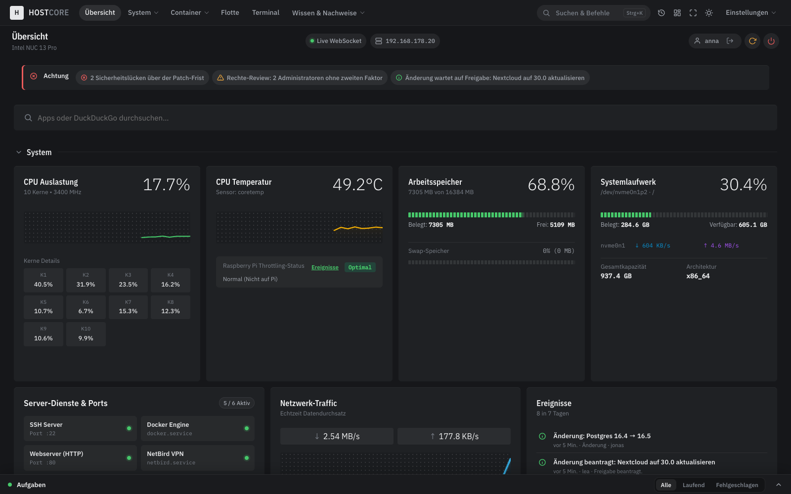
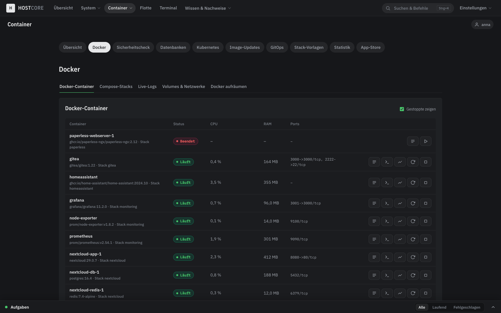
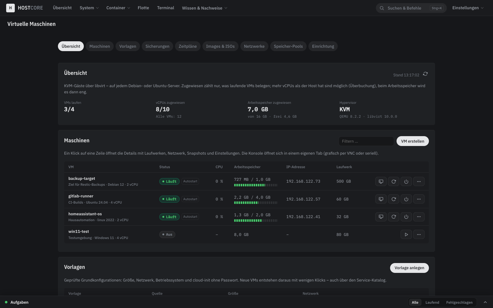
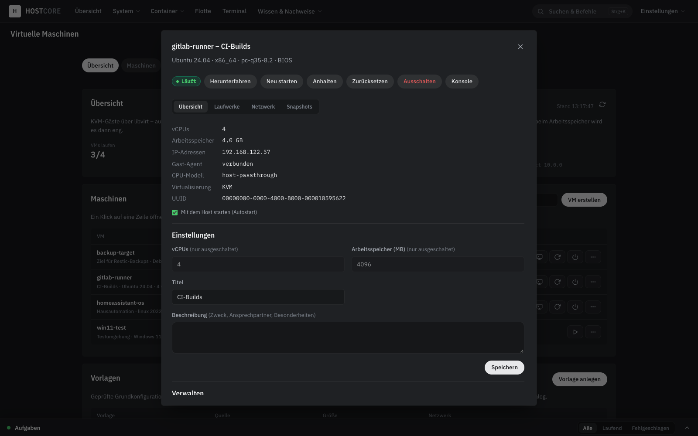
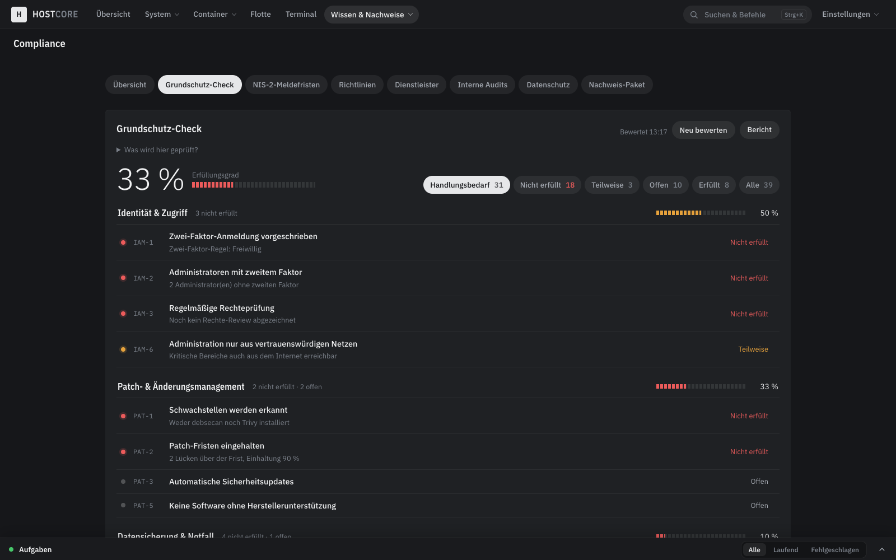
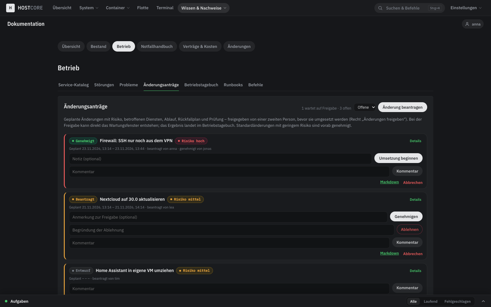
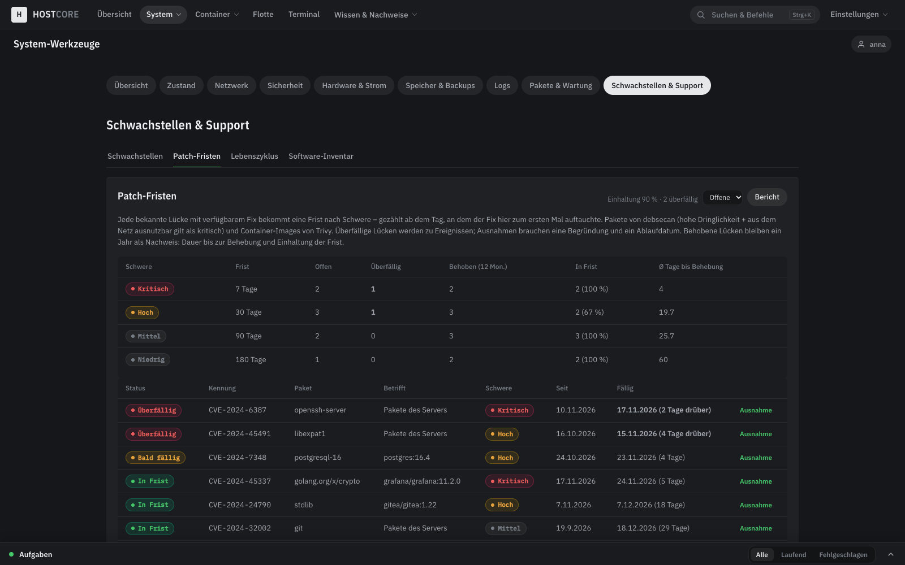
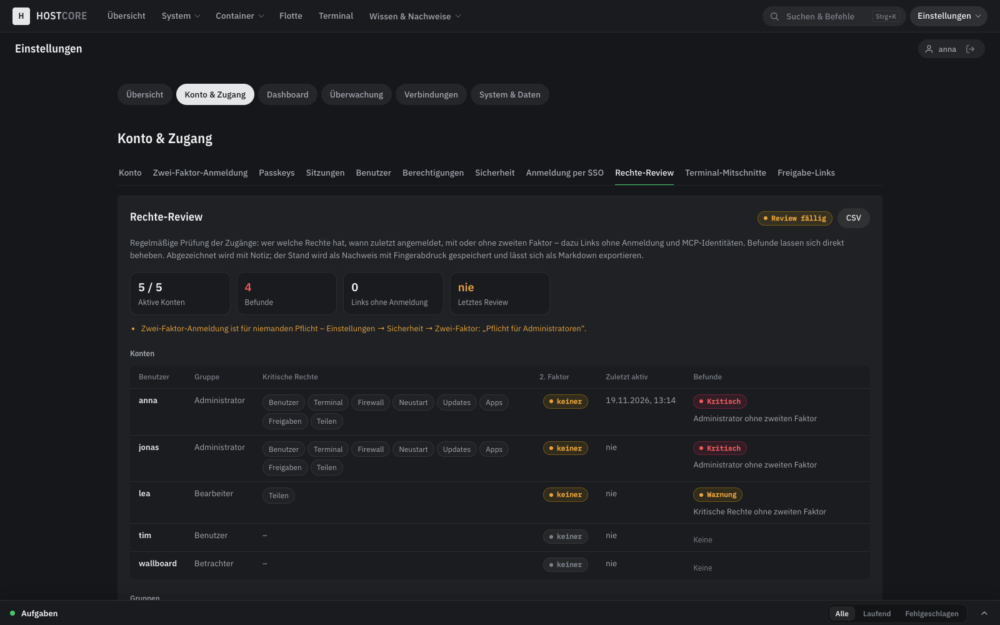
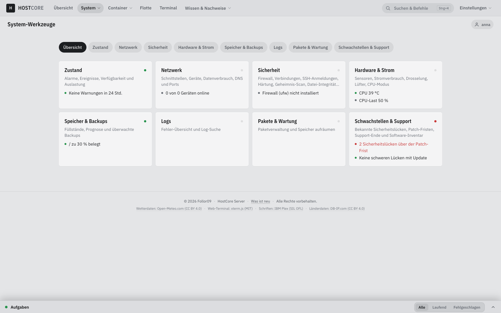

# HostCore – server & homelab dashboard for Debian, Ubuntu and Raspberry Pi

**One self-hosted dashboard for your Linux server or Raspberry Pi: monitoring, Docker & k3s, virtual machines (KVM), GitOps, a web terminal, documentation – and compliance built in.**

Instead of stitching together a start page, a container UI, a VM manager, a server admin panel and a wiki, HostCore does it in one place – and adds what homelab tools usually leave out: change requests with four-eyes approval, an emergency handbook generated from your setup, patch deadlines, access reviews, a BSI IT-Grundschutz–style baseline check, GDPR records of processing and an evidence package for auditors.

> 🇩🇪 Deutsche Fassung mit allen Details: **[README.de.md](README.de.md)** · Getting started: **[docs/GETTING-STARTED.md](docs/GETTING-STARTED.md)**
> The interface is German by default; an English translation can be switched on (Settings → Language). MIT licensed.



## Install

On any 64-bit Debian 12+ or Ubuntu 22.04+ machine – a PC, a mini server, a VM or a Raspberry Pi (Pi 5 recommended, Pi 4 works) with Raspberry Pi OS – and a user with `sudo`:

```bash
curl -fsSL https://github.com/Follor09/HostCore/releases/latest/download/setup.sh | bash
```

`setup.sh` installs git if needed, clones the newest release to `~/pi-dashboard` and runs `install.sh`. Run as plain root (e.g. a fresh VPS), it creates a user `hostcore` for the dashboard (`--user <name>` for another one). For an agent: `… | bash -s -- --agent --from <main-dashboard-ip>`. Or by hand:

```bash
git clone https://github.com/Follor09/HostCore.git ~/pi-dashboard
~/pi-dashboard/install.sh
```

`install.sh` sets up the virtualenv, the systemd service, the update timer and narrowly scoped sudo rules, then asks for the first administrator. Open `http://<server-ip>:8000`. Docker, k3s and KVM are optional – their sections appear once they are installed; virtualisation can be set up from the VMs page in two clicks.

**Updates:** a fresh install follows the **stable channel** – only published releases (`vX.Y.Z` tags), never back to an older one. Want every commit? Settings → Auto-Update → *Jeder Commit (main)*. Everything that runs as root comes from a root-owned copy of this repository, see [SECURITY.md](SECURITY.md).

## Why HostCore

| | HostCore | Homarr | Portainer | Cockpit |
|---|:---:|:---:|:---:|:---:|
| Start page with apps & widgets | ✓ | ✓ | – | – |
| Docker containers & compose stacks | ✓ | basic | ✓ | Podman |
| Virtual machines (KVM/libvirt) with console | ✓ | – | – | ✓ |
| Stacks deployed from Git (GitOps) | ✓ | – | ✓ | – |
| Services, packages, firewall, web terminal | ✓ | – | – | ✓ |
| Hardware monitoring incl. Raspberry Pi specifics (throttling, power, fan curve) | ✓ | – | – | basic |
| Runbooks, emergency handbook, change requests | ✓ | – | – | – |
| Baseline check, GDPR records/TOM, evidence export | ✓ | – | – | – |

<sub>Compared by each project's core focus – they are excellent tools; check their docs for details. HostCore is built for one server (or a small fleet via agents), not for large clusters.</sub>

## Highlights

**Run it**
- Live hardware monitoring (CPU, temperature, NVMe health; on the Pi also throttling and Pi 5 power), 24 h / 7 day history, anomaly detection, capacity forecasts
- **Virtual machines** (KVM/libvirt, inspired by Cockpit): create from Debian/Ubuntu cloud images with cloud-init (user, SSH key, guest agent) or from an ISO, start/stop, vCPUs and memory, disks, ISO, network cards, snapshots, clone, virtual networks and storage pools, graphical (noVNC) and serial console in the browser; optional per server (Settings → *Virtuelle Maschinen*), not offered on a Raspberry Pi
- **VM operations:** templates, full backups while a VM runs, restore as a new VM, schedules for snapshots, backups, start and shutdown, and live migration between servers with a check first
- **Off-site backup:** Docker volumes and stacks, Kubernetes (k3s) volumes, the dashboard's data with its database dumps, system settings, logs or own folders – to Google Drive, Dropbox, Nextcloud/WebDAV, S3-compatible storage or a USB drive, on a schedule; restic encrypts on the server, transfers only changes and prunes old states; browse states and restore from the dashboard ([guide in German](docs/EXTERNE-SICHERUNG.md): setup, own Google client ID, restore without the server, removal)
- Docker & k3s: containers, compose stacks, live logs, database monitor with dumps, image update checks, app store, stack templates
- **GitOps:** compose stacks from a Git repository – diff of new commits, deploy as a task (databases dumped first, health check last), automatic mode, drift detection, deploy webhook
- Persistent web terminal (tmux) with sharing and recordings (playback and full-text search of what was typed and shown, under Settings → Terminal recordings or *Recordings* in the terminal), file browser, task log like Proxmox, fleet of servers via agents – a Raspberry Pi, a Debian or Ubuntu machine or VM each run the agent (`./install.sh --agent --from <main-dashboard-ip>`)

**Secure it**
- Users, groups and 24 fine-grained permissions; 2FA (TOTP), passkeys, **single sign-on via OpenID Connect** (Pocket ID, Authentik, Keycloak …)
- Hardening check, vulnerability scan (debsecan, Trivy) with **patch deadlines**, compose security check, **image policies** that can block deployments, **secret scan**
- Tamper-evident activity log (SHA-256 chain), confirm-again for critical changes, areas restricted to home network/VPN, Cloudflare/reverse proxy aware

**Document & prove it**
- Inventory, service profiles, runbooks, operations journal, incidents with post-mortems, **problem management**
- **Change requests** with four-eyes approval, maintenance windows and journal entries
- **Emergency handbook** with restore commands per service, generated from stacks, backups, dumps and GitOps – print or Markdown for offline storage
- **Compliance page:** baseline check modelled on BSI IT-Grundschutz / CIS (mostly rated automatically), GDPR records of processing and TOM, **access review** with sign-off, **evidence package** (ZIP with SHA-256 manifest) for auditors and customers
- **Security watchers:** file integrity that explains package updates and approved changes, sudo log per user and server, ClamAV and rkhunter on a schedule, Falco for running containers
- **NIS-2 deadlines** (§ 32 BSIG, Art. 33 GDPR), **policies** with acknowledgement, **supplier register** and **internal audits** with corrective actions
- **Service catalog:** standard requests as forms with approval, fulfilled as a task, change request, VM or quick action

**Use it**
- A calm interface modelled on instrument panels: readings in large figures, meters as LED segments, colour only for status; dark and light theme with a choice of signal colour
- One navigation bar on every page – hover a page to jump straight into one of its groups; long pages show one section at a time
- Built to stay responsive on a Raspberry Pi: one shared measurement for all open tabs, background tabs pause their live data, long checks run apart from everything else

Plus: Homarr-style boards, command palette (Ctrl+K), alerting with escalation, e-mail reports, public status page, NetBox integration, built-in MCP server for Claude.

## Screenshots

| | |
|---|---|
|  |  |
| Containers & compose stacks | Virtual machines (KVM) |
|  |  |
| VM details with console, disks and snapshots | Baseline check, filtered to what needs doing |
|  |  |
| Change requests with four-eyes approval | Patch deadlines per severity |
|  |  |
| Access review | Light theme: System-Werkzeuge overview |

<sub>Screenshots from a demo server with sample data.</sub>

## Security model in short

HostCore is meant for the home network or behind a VPN / Cloudflare Access – it includes a web terminal and service control. The app runs as a normal user; root actions come only from a root-owned copy of the repo with sudo limited to exactly those scripts. Every request is checked against one permission table. Details and how to report a vulnerability: [SECURITY.md](SECURITY.md).

**Running it on the internet** (*Settings → Security*, with a checklist): choose "Cloudflare" or "own reverse proxy" so login limits and the activity log see the real visitor, require two-factor login (TOTP or passkeys) for administrators, and keep the terminal and user management reachable only from the home network / VPN. Optional: single sign-on via OpenID Connect (Pocket ID, Authentik, Keycloak …), re-confirmation before critical changes, an access review every 90 days.

## Updates

*Settings → Auto-update* picks the channel: **stable** (default for new installs) follows releases only – tags `vX.Y.Z`, never back to an older one; **main** takes every commit. A timer checks GitHub every minute, installs changed dependencies before switching the code (a failed `pip` keeps the old version running) and restarts the service. Log: `journalctl -u pi-dashboard-update -f`.

- **Root never runs code from the dashboard folder:** scripts and unit files that run as root come from a separate, root-owned clone in `/var/lib/pi-dashboard/src`.
- **Signed releases:** releases are signed with the HostCore release key (`.github/allowed_signers`). `install.sh` stores that key once as a trust anchor in `/var/lib/pi-dashboard/allowed_signers`; from then on the stable channel installs only releases signed with it, so a release pushed with stolen GitHub access alone is not installed. Off: create `/var/lib/pi-dashboard/allowed_signers.off` before installing, or delete the anchor. The *main* channel follows unsigned commits – use *stable* where that matters. **Key change:** put the new key into `.github/allowed_signers` and sign that one release with the old key – servers take the new list from that signed release (only from a release signed with a key they already trust), from then on only the new key counts. Servers that miss the change release install it first, before newer ones.
- **Tested dependency versions:** `requirements.txt` has upper bounds; Dependabot proposes newer versions, CI tests them on Python 3.10–3.13, and a release is only published when all checks pass.

## Remote servers (agents)

Further servers run the agent (`./install.sh --agent --from <main-dashboard-ip>`, or `setup.sh … --agent --from …`) and are added under *Settings → Remote servers*; the switch at the top right then shows and controls the selected server with all features. The agent only answers the main dashboard (token, optionally limited to its address).

**Encryption:** main dashboard and agent talk plain http – fine in the LAN or through a VPN (WireGuard, NetBird, Tailscale). Over the internet (e.g. a VPS controlling a Pi at home) token, terminal and files could be read on the way: connect such agents through a VPN, or switch the agent to https with `./agent.sh tls on` – the main dashboard then pins the agent's certificate when it is added. Remote servers reached with plain http at a public address are marked *Unverschlüsselt* in the settings and the self-test.

## Project layout

`app.py` is the entry point, the feature modules live in `backend/`, the web interface in `static/`, guides and screenshots in `docs/`. Install, update and helper scripts stay in the top folder.

## Contributing

Issues and pull requests are welcome – see [CONTRIBUTING.md](CONTRIBUTING.md). Ideas that fit: practical features for running a server, a Pi or a small homelab professionally.

## License

[MIT](LICENSE)
