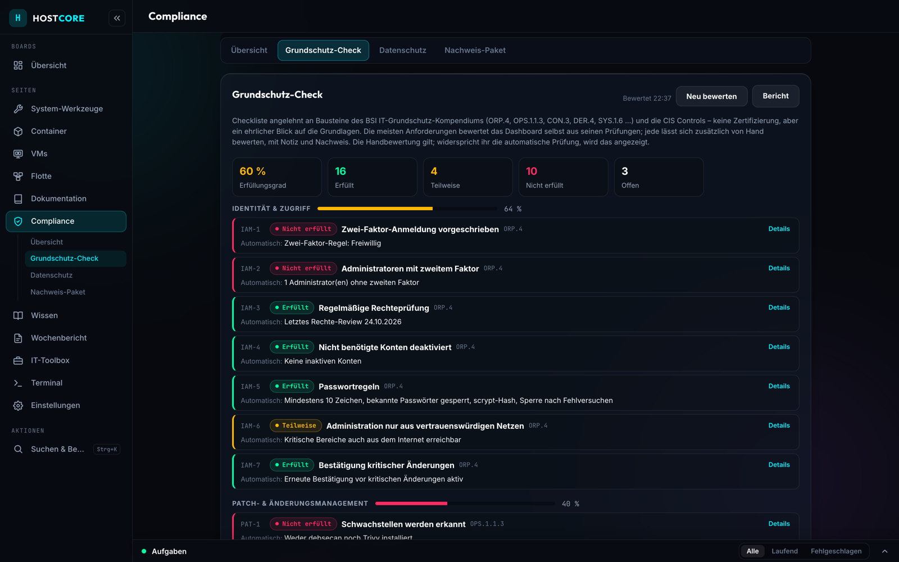
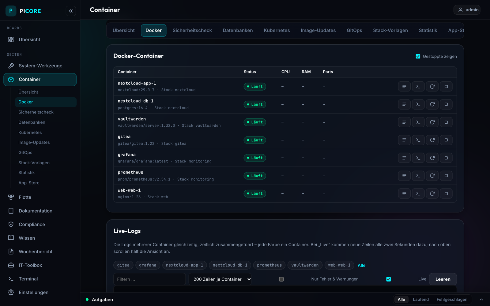
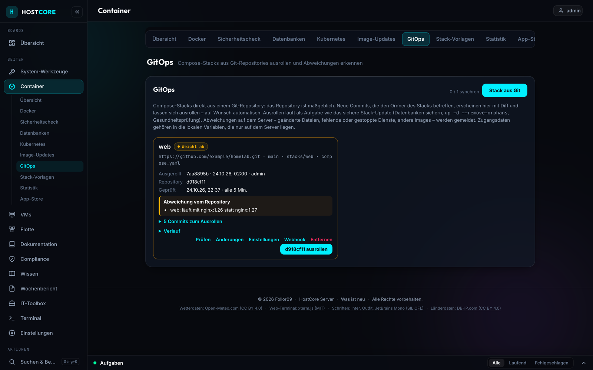
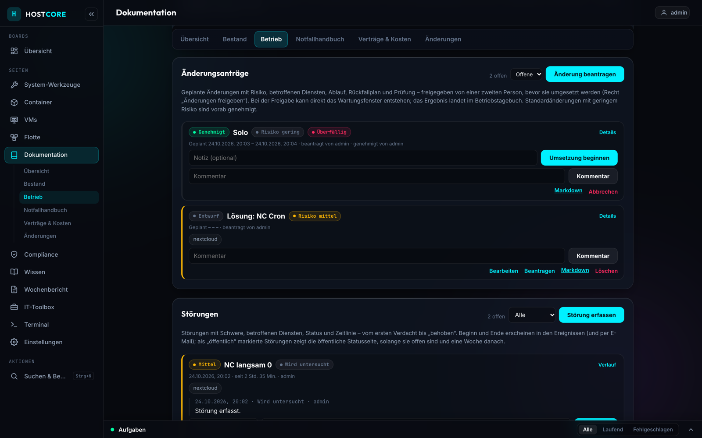
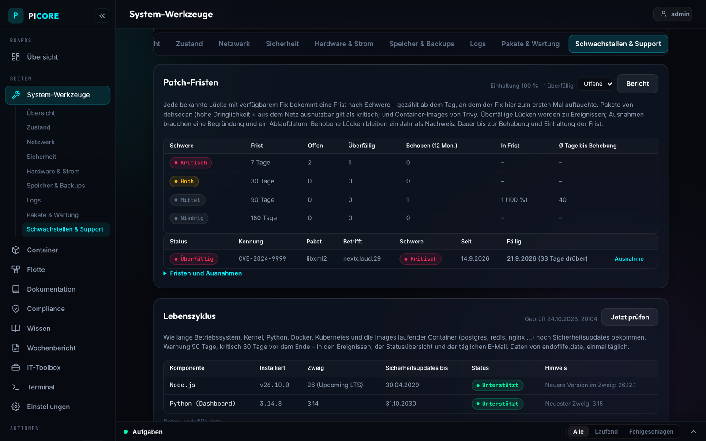
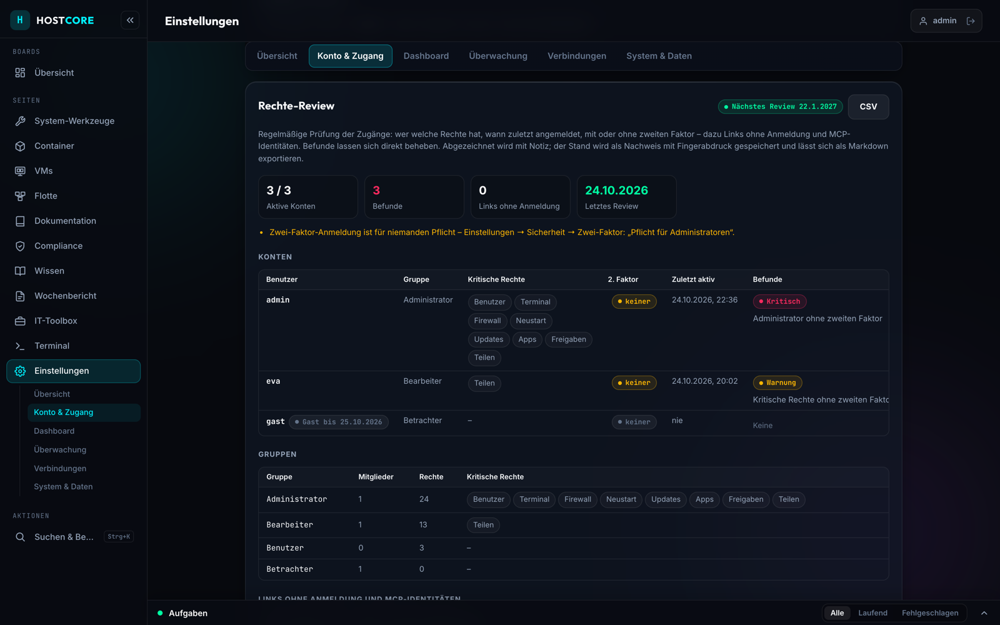

# PiCore – Raspberry Pi server & homelab dashboard

**One self-hosted dashboard for your Raspberry Pi: monitoring, Docker & k3s, GitOps, a web terminal, documentation – and compliance built in.**

Instead of stitching together a start page, a container UI, a server admin panel and a wiki, PiCore does it in one place – and adds what homelab tools usually leave out: change requests with four-eyes approval, an emergency handbook generated from your setup, patch deadlines, access reviews, a BSI IT-Grundschutz–style baseline check, GDPR records of processing and an evidence package for auditors.

> 🇩🇪 Deutsche Fassung mit allen Details: **[README.de.md](README.de.md)** · Getting started: **[docs/GETTING-STARTED.md](docs/GETTING-STARTED.md)**
> The interface is German by default; an English translation can be switched on (Settings → Language). MIT licensed.



## Install

On a Raspberry Pi (Pi 5 recommended, Pi 4 works) with Raspberry Pi OS / Debian 12+ (64-bit) and a user with `sudo`:

```bash
git clone https://github.com/Follor09/RaspberryPi-Dash.git ~/pi-dashboard
~/pi-dashboard/install.sh
```

`install.sh` sets up the virtualenv, the systemd service, the update timer and narrowly scoped sudo rules, then asks for the first administrator. Open `http://<pi-ip>:8000`. Docker and k3s are optional – their sections appear once they are installed.

**Updates:** a fresh install follows the **stable channel** – only published releases (`vX.Y.Z` tags), never back to an older one. Want every commit? Settings → Auto-Update → *Jeder Commit (main)*. Everything that runs as root comes from a root-owned copy of this repository, see [SECURITY.md](SECURITY.md).

## Why PiCore

| | PiCore | Homarr | Portainer | Cockpit |
|---|:---:|:---:|:---:|:---:|
| Start page with apps & widgets | ✓ | ✓ | – | – |
| Docker containers & compose stacks | ✓ | basic | ✓ | Podman |
| Stacks deployed from Git (GitOps) | ✓ | – | ✓ | – |
| Services, packages, firewall, web terminal | ✓ | – | – | ✓ |
| Raspberry Pi hardware (temperature, throttling, power, fan curve) | ✓ | – | – | – |
| Runbooks, emergency handbook, change requests | ✓ | – | – | – |
| Baseline check, GDPR records/TOM, evidence export | ✓ | – | – | – |

<sub>Compared by each project's core focus – they are excellent tools; check their docs for details. PiCore is built for one Pi (or a small fleet via agents), not for large clusters.</sub>

## Highlights

**Run it**
- Live hardware monitoring (CPU, temperature, throttling, NVMe health, Pi 5 power), 24 h / 7 day history, anomaly detection, capacity forecasts
- Docker & k3s: containers, compose stacks, live logs, database monitor with dumps, image update checks, app store, stack templates
- **GitOps:** compose stacks from a Git repository – diff of new commits, deploy as a task (databases dumped first, health check last), automatic mode, drift detection, deploy webhook
- Persistent web terminal (tmux) with sharing and recordings, file browser, task log like Proxmox, fleet of Pis via agents

**Secure it**
- Users, groups and 22 fine-grained permissions; 2FA (TOTP), passkeys, **single sign-on via OpenID Connect** (Pocket ID, Authentik, Keycloak …)
- Hardening check, vulnerability scan (debsecan, Trivy) with **patch deadlines**, compose security check, **image policies** that can block deployments, **secret scan**
- Tamper-evident activity log (SHA-256 chain), confirm-again for critical changes, areas restricted to home network/VPN, Cloudflare/reverse proxy aware

**Document & prove it**
- Inventory, service profiles, runbooks, operations journal, incidents with post-mortems, **problem management**
- **Change requests** with four-eyes approval, maintenance windows and journal entries
- **Emergency handbook** with restore commands per service, generated from stacks, backups, dumps and GitOps – print or Markdown for offline storage
- **Compliance page:** baseline check modelled on BSI IT-Grundschutz / CIS (mostly rated automatically), GDPR records of processing and TOM, **access review** with sign-off, **evidence package** (ZIP with SHA-256 manifest) for auditors and customers

Plus: Homarr-style boards, command palette (Ctrl+K), alerting with escalation, e-mail reports, public status page, NetBox integration, built-in MCP server for Claude.

## Screenshots

| | |
|---|---|
|  |  |
| Containers & stacks | GitOps with diff and drift |
|  |  |
| Change requests with four-eyes approval | Patch deadlines per severity |
|  |  |
| Access review | Baseline check |

## Security model in short

PiCore is meant for the home network or behind a VPN / Cloudflare Access – it includes a web terminal and service control. The app runs as a normal user; root actions come only from a root-owned copy of the repo with sudo limited to exactly those scripts. Every request is checked against one permission table. Details and how to report a vulnerability: [SECURITY.md](SECURITY.md).

## Project layout

`app.py` is the entry point, the feature modules live in `backend/`, the web interface in `static/`, guides and screenshots in `docs/`. Install, update and helper scripts stay in the top folder.

## Contributing

Issues and pull requests are welcome – see [CONTRIBUTING.md](CONTRIBUTING.md). Ideas that fit: practical features for running a Pi or a small homelab professionally.

## License

[MIT](LICENSE)
